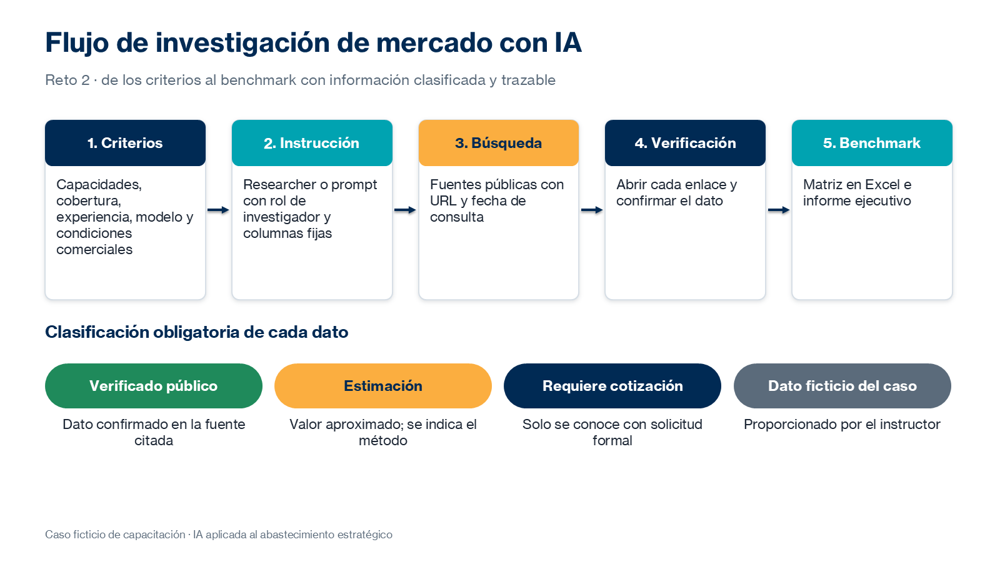

# Práctica 2. Investigación de mercado

## Metadatos

| Elemento | Valor |
|---|---|
| Duración | 100 minutos (Actividad 1: 20 min · Actividad 2: 40 min · Actividad 3: 40 min) + 10 minutos de discusión grupal |
| Complejidad | Media |
| Nivel de Bloom | Analizar |

## Descripción General

> Caso transversal ficticio: el proveedor tecnológico actual de Nequi propone un incremento del 18 % en sus tarifas. Antes de aceptar, el equipo de Abastecimiento necesita investigar el mercado, identificar proveedores alternativos y evaluar la competitividad de la propuesta.

En este reto diseñas una investigación de mercado, la ejecutas con fuentes públicas mediante Researcher o prompts especializados con rol de investigador, y construyes un benchmark que compara al proveedor actual del caso con las alternativas identificadas. Debes distinguir con claridad tres tipos de información: datos de proveedores reales verificados en fuentes públicas, estimaciones y condiciones que solo pueden conocerse mediante una cotización formal. Cuando no exista información comercial pública suficiente, usas los datos ficticios del instructor, identificándolos como tales.



### Actividades del reto (100 minutos)

| Actividad | Duración | Producto |
|---|---|---|
| 1. Diseño de la investigación | 20 min | Criterios e instrucción de investigación |
| 2. Investigación del mercado | 40 min | Proveedores con fuentes y datos clasificados |
| 3. Construcción del benchmark | 40 min | Benchmark en Excel e informe ejecutivo en Word |

**Entregable del reto:** benchmark de proveedores en Excel e informe ejecutivo de investigación de mercado en Word.

## Objetivos de Aprendizaje

- [ ] Establecer criterios de investigación de proveedores de servicios tecnológicos.
- [ ] Preparar instrucciones para Researcher o prompts con rol de investigador para Claude y Copilot Chat.
- [ ] Investigar proveedores alternativos con fuentes públicas verificables.
- [ ] Clasificar cada dato como verificado público, estimación, requiere cotización o dato ficticio del caso.
- [ ] Construir un benchmark en Excel y un informe ejecutivo con fuentes y preguntas comerciales.

## Prerrequisitos

**Conocimientos**

- Práctica 1 completada (matriz de oportunidades y propuesta de aplicación).
- Haber participado en la introducción del módulo 2: técnicas de prompting para investigación, validación de fuentes y diferencias entre herramientas conversacionales y agentes.
- Conocimientos funcionales de creación de prompts.

**Acceso**

- Microsoft 365 Copilot Chat (licencia básica) o Claude (plan gratuito) con búsqueda web habilitada.
- Opcional: agente Researcher de Microsoft 365 Copilot.
- Microsoft Excel y Microsoft Word.
- Archivos: [assets/reto02-datos-ficticios-mercado.xlsx](../assets/reto02-datos-ficticios-mercado.xlsx) y hoja `R2_Benchmark` de [assets/plantillas-retos.xlsx](../assets/plantillas-retos.xlsx).
- Usa solo fuentes públicas e información ficticia del caso.

## Entorno de Laboratorio

| Recurso | Versión, edición y arquitectura | Uso |
|---|---|---|
| Microsoft 365 Copilot Chat | Servicio SaaS vigente, licencia básica; arquitectura no aplicable. Fuente oficial: https://learn.microsoft.com/es-es/copilot/overview | Investigación con información web y citas. |
| Claude | Plan gratuito vigente; búsqueda web según disponibilidad; arquitectura no aplicable. Fuente oficial: https://support.claude.com/en/articles/10684626-enabling-and-using-web-search | Investigación con prompt de investigador. |
| Researcher (opcional) | Agente de Microsoft 365 Copilot; requiere licencia Microsoft 365 Copilot. Fuente oficial: https://support.microsoft.com/es-es/topic/e63ab760-f3de-4c47-ae87-dad601b0e9c4 | Investigación de varios pasos con informe citado. |
| Microsoft Excel y Word | Microsoft 365, versión web o de escritorio vigente. Fuente oficial: https://support.microsoft.com/es-es/excel | Benchmark e informe ejecutivo. |

### Consideraciones de licencia y configuración

- Verifica que la búsqueda web esté habilitada en tu herramienta; sin ella, la IA responde con conocimiento que puede estar desactualizado.
- Researcher puede tardar varios minutos en generar su informe; inícialo al comienzo de la Actividad 2.
- Los prompts especializados emulan la función de investigación, pero no ofrecen las mismas capacidades técnicas que Researcher.
- Los nombres TecnoSoporte Andino, Nubia Servicios Digitales y Orbital IT Services son ficticios.

### Preparación del espacio de trabajo

Crea la subcarpeta:

`/Curso-IA-Abastecimiento/Reto02`

Crea los archivos:

- `R2_Benchmark_Proveedores.xlsx` (a partir de la hoja `R2_Benchmark` de la plantilla)
- `R2_Informe_Investigacion_Mercado.docx`

## Instrucciones Paso a Paso

### Actividad 1. Diseño de la investigación — 20 min

#### Paso 1: Definir la pregunta y los criterios de investigación

**Objetivo:** Delimitar qué se investigará y con qué criterios.

**Instrucciones:**

1. Escribe la pregunta de investigación: «¿Es competitivo el incremento del 18 % frente a las alternativas disponibles en el mercado?».
2. Define los criterios y anótalos en el informe:
   - Capacidades técnicas: soporte N1-N3, monitoreo 24x7, NOC, herramientas.
   - Cobertura: presencia en Colombia, horarios, idioma.
   - Experiencia: clientes del sector financiero, certificaciones y casos públicos.
   - Modelos de servicio: precio fijo, por consumo, por ticket o mixto.
   - Condiciones comerciales: información pública de precios, plazos y esquemas.

**Resultado esperado:** Pregunta y cinco criterios documentados.

**Verificación:** Cada criterio puede convertirse en una columna del benchmark.

#### Paso 2: Preparar la instrucción de investigación

**Objetivo:** Configurar la herramienta con un rol de investigador y reglas de clasificación.

**Instrucciones:**

1. Si usas Claude o Copilot Chat, prepara este prompt; si usas Researcher, adáptalo como instrucción del agente:

```text
Actúa como investigador de mercado de servicios tecnológicos para el sector
financiero en Colombia.

Objetivo: identificar proveedores de soporte, monitoreo 24x7 y continuidad operativa
de plataformas digitales.

Para cada proveedor indica: servicios, cobertura, experiencia en banca, modelo de
contratación e información comercial pública.

Formato: tabla con columnas Proveedor | Servicios | Cobertura | Experiencia | Modelo |
Precio público | Fuente (URL) | Fecha de consulta.

Si un dato no es público, escribe «Requiere cotización». No estimes precios sin
indicarlo. Señala qué datos no pudiste verificar.
```

2. Guarda la instrucción en el informe, sección «Metodología».

**Resultado esperado:** Instrucción lista con rol, criterios, formato y reglas.

**Verificación:** La instrucción exige URL y fecha de consulta para cada dato.

### Actividad 2. Investigación del mercado — 40 min

#### Paso 3: Ejecutar la investigación

**Objetivo:** Identificar al menos tres proveedores reales con fuentes públicas.

**Instrucciones:**

1. Ejecuta la instrucción en tu herramienta con la búsqueda web activa.
2. Pide profundizar en cada proveedor relevante con un segundo prompt:

```text
Para el proveedor [nombre], amplía la información de servicios gestionados y modelo
de contratación. Cita solo páginas oficiales o informes públicos e indica la fecha.
```

3. Copia los resultados a la hoja `R2_Benchmark`.

**Resultado esperado:** Tres o más proveedores reales con información y fuentes.

**Verificación:** Cada proveedor tiene al menos una fuente con URL.

#### Paso 4: Verificar las fuentes y clasificar la información

**Objetivo:** Asegurar la trazabilidad de cada dato.

**Instrucciones:**

1. Abre cada URL y confirma que contiene el dato citado.
2. Evalúa la fuente con los criterios de autoridad, vigencia, exactitud, objetividad y consistencia.
3. Clasifica cada dato en la columna `Clasificación del dato`:
   - `Verificado público`
   - `Estimación`
   - `Requiere cotización`
   - `Dato ficticio del caso`
4. Elimina o marca como no verificado cualquier dato cuya fuente no lo contenga.

**Resultado esperado:** Todos los datos del benchmark clasificados.

**Verificación:** Ninguna cifra de precio de un proveedor real aparece sin fuente o sin la etiqueta `Estimación`.

### Actividad 3. Construcción del benchmark — 40 min

#### Paso 5: Construir el benchmark

**Objetivo:** Comparar al proveedor actual con las alternativas.

**Instrucciones:**

1. Agrega al benchmark el proveedor actual del caso (TecnoSoporte Andino, +18 %) con la etiqueta `Dato ficticio del caso`.
2. Abre [assets/reto02-datos-ficticios-mercado.xlsx](../assets/reto02-datos-ficticios-mercado.xlsx) y agrega Nubia y Orbital como referencia comercial ficticia.
3. Agrega una columna `Tipo` con los valores `Real investigado` o `Ficticio del caso`.
4. Identifica oportunidades de negociación: condiciones del mercado que superan la propuesta del proveedor actual.

**Resultado esperado:** Benchmark que separa claramente proveedores reales y ficticios.

**Verificación:** Un lector puede distinguir en cada fila qué información es real, ficticia o no verificada.

#### Paso 6: Elaborar el informe ejecutivo

**Objetivo:** Comunicar los hallazgos con fuentes y preguntas para cotización.

**Instrucciones:**

1. Pide a la IA un borrador a partir de tu benchmark:

```text
Con base en el benchmark adjunto, redacta un informe ejecutivo de una página con:
resumen, proveedores identificados, competitividad del incremento del 18 %,
vacíos de información y preguntas para solicitar información comercial. Distingue
datos verificados, estimaciones y datos ficticios. No agregues información nueva.
```

2. Revisa el borrador frente al benchmark y corrige cualquier dato no sustentado.
3. Completa la sección de preguntas comerciales: tarifa y modelo de precios, costos de transición, SLA, penalizaciones, plazo y terminación, experiencia en banca y certificaciones.
4. Agrega la lista de fuentes con fecha de consulta.

**Resultado esperado:** Informe ejecutivo verificado.

**Verificación:** Todas las afirmaciones del informe se encuentran en el benchmark.

### Discusión grupal — 10 min

#### Paso 7: Participar en la discusión grupal

**Objetivo:** Contrastar proveedores, fuentes y herramientas.

**Instrucciones:**

1. Comparte cuántos proveedores identificaste y cuántos datos pudiste verificar.
2. Compara los resultados de Researcher con los de los prompts de investigación.
3. Registra en el informe la técnica de prompting que más mejoró tu resultado.

**Resultado esperado:** Conclusiones del grupo registradas.

**Verificación:** El informe incluye una observación sobre la calidad de las fuentes.

## Validación y Pruebas

La práctica se considera lograda cuando se cumplen todos los criterios medibles siguientes:

| Criterio | Evidencia mínima | Resultado requerido |
|---|---|---|
| Diseño de la investigación | Sección «Metodología» del informe | Pregunta, cinco criterios e instrucción de investigación. |
| Proveedores investigados | `R2_Benchmark_Proveedores.xlsx` | Tres o más proveedores reales con fuente y fecha. |
| Clasificación | Columna `Clasificación del dato` | 100 % de los datos clasificados. |
| Separación real / ficticio | Columna `Tipo` | Proveedores reales y ficticios identificados. |
| Informe ejecutivo | `R2_Informe_Investigacion_Mercado.docx` | Resumen, competitividad del +18 %, vacíos, preguntas y fuentes. |

### Caso adversarial: fuente que no contiene el dato

Analiza esta situación: la IA afirma que un proveedor cobra «COP 95 millones mensuales por soporte 24x7» y cita una URL que, al abrirla, solo describe sus servicios.

**Resultado esperado de la evaluación humana:**

- Clasificación: dato no verificado.
- Acción: eliminar la cifra del benchmark o marcarla como `Estimación` con la advertencia correspondiente, y agregar la pregunta a la solicitud de cotización.
- Aprendizaje: una cita no garantiza que el dato esté en la fuente; cada URL se abre y se revisa.

## Solución de Problemas

### Problema 1: La herramienta no muestra fuentes

**Síntoma:** La respuesta no incluye URL ni citas.

**Causa probable:** La búsqueda web está desactivada o el prompt no exige fuentes.

**Solución:** Activa la búsqueda web en la herramienta y agrega al prompt: «Incluye la URL y la fecha de consulta de cada dato».

### Problema 2: No hay precios públicos de proveedores reales

**Síntoma:** Ningún proveedor publica tarifas para servicios comparables.

**Causa probable:** Los servicios gestionados se cotizan de forma personalizada.

**Solución:** Clasifica esos datos como `Requiere cotización`, usa los datos ficticios del instructor como referencia y agrega las preguntas comerciales al informe. Es un resultado válido del reto.

## Limpieza

1. Guarda el benchmark y el informe en `/Curso-IA-Abastecimiento/Reto02`.
2. Conserva la instrucción de investigación para la biblioteca de prompts del reto 7.
3. No guardes en el benchmark información confidencial de proveedores obtenida fuera de fuentes públicas.

## Resumen (+ optional resources)

En este reto se aplicaron técnicas de prompting para investigación, se validaron fuentes y se construyó un benchmark que separa con claridad datos verificados, estimaciones, condiciones que requieren cotización y datos ficticios del caso. El informe ejecutivo resume la competitividad del incremento propuesto y los vacíos de información.

El benchmark es la referencia para evaluar las propuestas del reto 3.

**Recursos opcionales:**

- Microsoft Support: [Introducción a Researcher en Microsoft 365 Copilot](https://support.microsoft.com/es-es/topic/e63ab760-f3de-4c47-ae87-dad601b0e9c4)
- Claude Help Center: [Enabling and using web search](https://support.claude.com/en/articles/10684626-enabling-and-using-web-search)
- Anthropic: [Give Claude a role (system prompts)](https://platform.claude.com/docs/en/build-with-claude/prompt-engineering/system-prompts)
- Anthropic: [Reduce hallucinations](https://platform.claude.com/docs/en/test-and-evaluate/strengthen-guardrails/reduce-hallucinations)

---

[Volver al inicio](../README.md)
