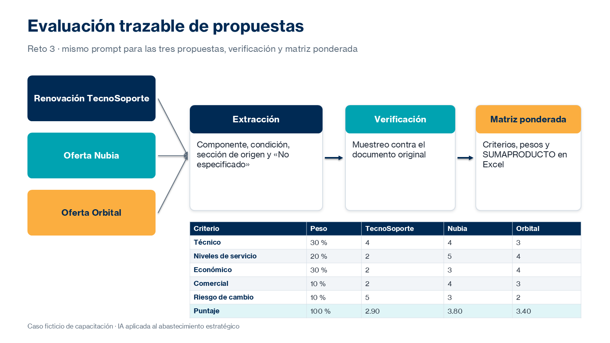

# Práctica 3. Evaluación comparativa de propuestas y preparación de argumentos comerciales

## Metadatos

| Elemento | Valor |
|---|---|
| Duración | 100 minutos (Actividad 1: 30 min · Actividad 2: 40 min · Actividad 3: 30 min) + 10 minutos de discusión grupal |
| Complejidad | Media |
| Nivel de Bloom | Evaluar |

## Descripción General

> Caso transversal ficticio: después de investigar el mercado, el equipo de Abastecimiento recibe la propuesta de renovación del proveedor actual y dos ofertas ficticias de proveedores alternativos. Debe comparar sus condiciones técnicas, económicas y comerciales para preparar la siguiente etapa de negociación.

En este reto usas tu herramienta de IA para extraer de cada propuesta las características técnicas, condiciones comerciales, alcance, niveles de atención, exclusiones e información faltante, conservando la trazabilidad con los documentos originales. Después defines criterios ponderados, construyes una matriz de evaluación en Excel y preparas preguntas de aclaración y condiciones negociables con el proveedor actual, usando las ofertas alternativas como referencia. El benchmark del reto 2 sirve como contexto para la evaluación.



### Actividades del reto (100 minutos)

| Actividad | Duración | Producto |
|---|---|---|
| 1. Extracción de información | 30 min | Tablas de extracción verificadas |
| 2. Evaluación comparativa | 40 min | Matriz de evaluación ponderada en Excel |
| 3. Preparación de la siguiente ronda | 30 min | Documento de preguntas comerciales en Word |

**Entregable del reto:** matriz de evaluación de proveedores en Excel y documento de preguntas comerciales en Word.

## Objetivos de Aprendizaje

- [ ] Extraer condiciones de propuestas comerciales con un mismo prompt y la sección de origen de cada dato.
- [ ] Identificar información faltante, exclusiones y ambigüedades.
- [ ] Definir criterios ponderados y construir una matriz de evaluación en Excel.
- [ ] Verificar las respuestas de la IA contra los documentos originales.
- [ ] Preparar preguntas de aclaración y condiciones negociables con el proveedor actual.

## Prerrequisitos

**Conocimientos**

- Prácticas 1 y 2 completadas.
- Haber participado en la introducción del módulo 3: criterios para comparar propuestas, información faltante y trazabilidad.
- Uso básico de fórmulas de Excel.

**Acceso**

- Microsoft 365 Copilot Chat (licencia básica) o Claude (plan gratuito) con carga de archivos.
- Opcional: agente Analyst de Microsoft 365 Copilot.
- Microsoft Excel y Microsoft Word.
- Archivos del reto:
  - [assets/reto03-propuesta-renovacion-tecnosoporte.docx](../assets/reto03-propuesta-renovacion-tecnosoporte.docx)
  - [assets/reto03-oferta-nubia.docx](../assets/reto03-oferta-nubia.docx)
  - [assets/reto03-oferta-orbital.docx](../assets/reto03-oferta-orbital.docx)
- Benchmark del reto 2.

## Entorno de Laboratorio

| Recurso | Versión, edición y arquitectura | Uso |
|---|---|---|
| Microsoft 365 Copilot Chat | Servicio SaaS vigente, licencia básica; arquitectura no aplicable. Fuente oficial: https://learn.microsoft.com/es-es/copilot/overview | Extracción y comparación con archivos cargados. |
| Claude | Plan gratuito vigente; carga de archivos sujeta a límites del plan. Fuente oficial: https://support.claude.com/en/articles/8241126-upload-files-to-claude | Alternativa para la extracción y el análisis. |
| Analyst (opcional) | Agente de Microsoft 365 Copilot; requiere licencia Microsoft 365 Copilot. Fuente oficial: https://support.microsoft.com/es-es/microsoft-365-copilot/get-started-with-analyst-in-microsoft-365-copilot | Profundizar el análisis comparativo. |
| Microsoft Excel y Word | Microsoft 365, versión web o de escritorio vigente. Fuente oficial: https://support.microsoft.com/es-es/excel | Matriz de evaluación y documento de preguntas. |

### Consideraciones de licencia y configuración

- Si tu herramienta no permite cargar archivos, copia el texto de cada propuesta en la conversación.
- En Claude gratuito, carga las tres propuestas en la misma conversación para reducir el consumo.
- El cálculo de puntajes se realiza siempre en Excel, no en la respuesta de la IA.

### Preparación del espacio de trabajo

Crea la subcarpeta:

`/Curso-IA-Abastecimiento/Reto03`

Crea los archivos:

- `R3_Matriz_Evaluacion.xlsx` (a partir de la hoja `R3_Evaluacion` de [assets/plantillas-retos.xlsx](../assets/plantillas-retos.xlsx))
- `R3_Preguntas_Comerciales.docx`

## Instrucciones Paso a Paso

### Actividad 1. Extracción de información — 30 min

#### Paso 1: Extraer la información de las propuestas

**Objetivo:** Obtener una tabla comparable por propuesta, con la sección de origen de cada dato.

**Instrucciones:**

1. Carga las tres propuestas en tu herramienta.
2. Envía el mismo prompt para cada una:

```text
Actúa como analista de abastecimiento. Analiza el documento [nombre] (propuesta ficticia).

Extrae en una tabla: Componente | Condición | Sección del documento | Observación.

Componentes: alcance, horario, disponibilidad, respuesta y resolución por severidad,
tarifa, periodicidad, ajustes, licencias o herramientas, exclusiones, plazo,
renovación, penalizaciones, terminación, transición.

Si un componente no aparece, escribe «No especificado». No interpretes ni completes
información que no esté en el documento.
```

3. Pega las tres tablas en una hoja `Extraccion` de tu Excel.

**Resultado esperado:** Tres tablas de extracción con la misma estructura.

**Verificación:** Cada condición indica la sección del documento.

#### Paso 2: Verificar la extracción y detectar información faltante

**Objetivo:** Confirmar los datos contra los documentos originales.

**Instrucciones:**

1. Verifica al menos cinco datos de cada propuesta en el documento original.
2. Revisa errores frecuentes: tarifas mensuales frente a anuales, valores con o sin IVA, condiciones atribuidas al proveedor equivocado, exclusiones omitidas.
3. Lista la información faltante. Ejemplo: Orbital no detalla el plan de continuidad ni los tiempos de resolución para severidades 2 y 3.
4. Registra en una columna `Verificado` el resultado: Correcto o Corregido.

**Resultado esperado:** Extracción verificada y lista de vacíos de información.

**Verificación:** Los valores clave coinciden con los documentos: TecnoSoporte COP 212,4 M y respuesta S1 de 30 min; Nubia COP 168 M más 18 M de licencias; Orbital COP 120 M con 150 tickets incluidos.

### Actividad 2. Evaluación comparativa — 40 min

#### Paso 3: Definir criterios y pesos

**Objetivo:** Establecer cómo se evaluarán las propuestas antes de calificarlas.

**Instrucciones:**

1. Define al menos cinco criterios y sus pesos. Ejemplo:

| Criterio | Peso | Qué se evalúa |
|---|---|---|
| Técnico | 30 % | Alcance, capacidades, herramientas, experiencia |
| Niveles de servicio | 20 % | Disponibilidad, tiempos de respuesta, penalizaciones |
| Económico | 30 % | Costo mensual, transición y costos adicionales |
| Comercial y contractual | 10 % | Plazo, renovación, terminación |
| Riesgo de cambio | 10 % | Complejidad de la transición y continuidad |

2. Define la escala: 1 = no cumple, 3 = cumple parcialmente, 5 = cumple o supera.
3. Justifica los pesos en una nota de la hoja.

**Resultado esperado:** Criterios y pesos que suman 100 %.

**Verificación:** La suma de los pesos es 100 % antes de calificar.

#### Paso 4: Construir la matriz de evaluación

**Objetivo:** Calificar las tres propuestas con apoyo de IA y calcular puntajes en Excel.

**Instrucciones:**

1. Pide a tu herramienta una propuesta de calificación justificada (o usa Analyst si lo tienes):

```text
Actúa como analista de abastecimiento. Con base en las tablas de extracción y los
criterios adjuntos, propone una calificación de 1 a 5 por criterio para cada
propuesta y justifica cada calificación citando la sección del documento.
No calcules el puntaje final.
```

2. Revisa cada calificación y ajústala con tu criterio profesional.
3. Calcula el puntaje ponderado en Excel con `=SUMAPRODUCTO(pesos; calificaciones)`.
4. Agrega una columna `Verificado contra` con la sección del documento que sustenta cada calificación.

**Resultado esperado:** Matriz con puntajes calculados en Excel.

**Verificación:** Con los pesos y calificaciones del ejemplo, los puntajes son TecnoSoporte 2,90; Nubia 3,80; Orbital 3,40.

### Actividad 3. Preparación de la siguiente ronda — 30 min

#### Paso 5: Analizar renovar frente a cambiar

**Objetivo:** Documentar ventajas y desventajas de cada opción.

**Instrucciones:**

1. En `R3_Preguntas_Comerciales.docx`, crea la sección «Renovar frente a cambiar».
2. Registra ventajas y desventajas de renovar con TecnoSoporte y de cambiar a Nubia u Orbital.
3. Pide a la IA que identifique argumentos que hayas omitido y valida cada uno contra las propuestas.

**Resultado esperado:** Análisis comparativo con al menos tres ventajas y tres desventajas por opción.

**Verificación:** Cada argumento remite a una condición de las propuestas o del benchmark.

#### Paso 6: Preparar preguntas y condiciones negociables

**Objetivo:** Preparar la siguiente ronda con el proveedor actual.

**Instrucciones:**

1. Redacta preguntas de aclaración por proveedor y por tema: alcance, niveles de servicio, precios y condiciones.
2. Elabora la lista de condiciones negociables con el proveedor actual, usando las ofertas como referencia. Ejemplos:
   - Reducir el incremento por debajo del 18 %.
   - Mantener la respuesta de 15 minutos en severidad 1.
   - Conservar un tope de penalizaciones de al menos 10 %.
   - Eliminar la renovación automática.
3. Agrega al documento la síntesis de la evaluación con los puntajes.

**Resultado esperado:** Documento de preguntas comerciales y condiciones negociables.

**Verificación:** Cada condición negociable cita la oferta alternativa o el dato que la respalda.

### Discusión grupal — 10 min

#### Paso 7: Participar en la discusión grupal

**Objetivo:** Contrastar matrices, criterios y errores detectados.

**Instrucciones:**

1. Compara tus pesos y puntajes con los de otro participante.
2. Comparte un error de interpretación de la IA que hayas corregido.
3. Registra una mejora a tu prompt de extracción.

**Resultado esperado:** Mejoras documentadas.

**Verificación:** El documento incluye al menos un ajuste al prompt de extracción.

## Validación y Pruebas

La práctica se considera lograda cuando se cumplen todos los criterios medibles siguientes:

| Criterio | Evidencia mínima | Resultado requerido |
|---|---|---|
| Extracción | Hoja `Extraccion` de `R3_Matriz_Evaluacion.xlsx` | Tres propuestas con la misma estructura y sección de origen. |
| Verificación | Columna `Verificado` | Cinco o más datos verificados por propuesta. |
| Información faltante | Lista de vacíos | Al menos un vacío identificado por propuesta. |
| Matriz ponderada | `R3_Matriz_Evaluacion.xlsx` | Pesos que suman 100 % y puntajes calculados con fórmula. |
| Preguntas y condiciones | `R3_Preguntas_Comerciales.docx` | Preguntas por tema y condiciones negociables sustentadas. |

### Caso adversarial: condición atribuida al proveedor equivocado

Analiza esta situación: la IA afirma que «TecnoSoporte ofrece 99,9 % de disponibilidad».

**Resultado esperado de la evaluación humana:**

- Clasificación: error de atribución; el 99,9 % corresponde a la oferta de Nubia.
- Acción: corregir la matriz con el valor de la propuesta de TecnoSoporte (99,5 %) y revisar las demás condiciones de esa respuesta.
- Aprendizaje: procesar las propuestas en tablas separadas y exigir la sección de origen reduce este tipo de error.

## Solución de Problemas

### Problema 1: La herramienta no puede leer el archivo

**Síntoma:** La IA indica que no puede abrir el documento o responde sin su contenido.

**Causa probable:** Límite de tamaño, formato no admitido o carga de archivos no disponible en la configuración.

**Solución:** Abre el documento en Word, copia su texto y pégalo en la conversación indicando el nombre de la propuesta.

### Problema 2: Los puntajes no coinciden con el ejemplo

**Síntoma:** El puntaje ponderado difiere de los valores de referencia.

**Causa probable:** Pesos expresados como enteros (30) en lugar de porcentajes (30 %), o rangos de la fórmula desalineados.

**Solución:** Verifica que los pesos sumen 1 (100 %) y que `SUMAPRODUCTO` use rangos del mismo tamaño. Diferencias por pesos o calificaciones propias son válidas si están justificadas.

## Limpieza

1. Guarda la matriz y el documento de preguntas en `/Curso-IA-Abastecimiento/Reto03`.
2. Conserva el prompt de extracción para la biblioteca del reto 7.
3. No modifiques los documentos originales de las propuestas.

## Resumen (+ optional resources)

En este reto se extrajeron condiciones de tres propuestas con trazabilidad, se verificaron contra los documentos, se evaluaron con criterios ponderados en Excel y se prepararon preguntas y condiciones negociables. El documento original prevalece siempre sobre la respuesta de la IA.

La matriz de evaluación y las condiciones negociables son insumo del análisis económico del reto 4.

**Recursos opcionales:**

- Microsoft Support: [Función SUMAPRODUCTO](https://support.microsoft.com/es-es/office/sumaproducto-funci%C3%B3n-16753e75-9f68-4874-94ac-4d2145a2fd2e)
- Microsoft Support: [Introducción a Analyst en Microsoft 365 Copilot](https://support.microsoft.com/es-es/microsoft-365-copilot/get-started-with-analyst-in-microsoft-365-copilot)
- Anthropic: [Use XML tags to structure your prompts](https://platform.claude.com/docs/en/build-with-claude/prompt-engineering/use-xml-tags)
- Claude Help Center: [Upload files to Claude](https://support.claude.com/en/articles/8241126-upload-files-to-claude)

---

[Volver al inicio](../README.md)
