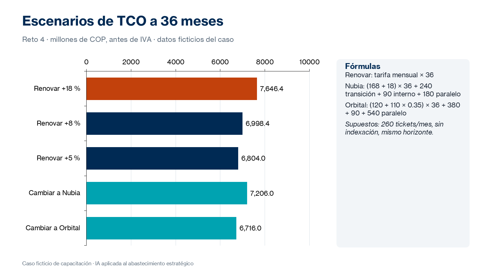

# Práctica 4. Análisis económico

## Metadatos

| Elemento | Valor |
|---|---|
| Duración | 100 minutos (Actividad 1: 30 min · Actividad 2: 40 min · Actividad 3: 30 min) + 10 minutos de discusión grupal |
| Complejidad | Alta |
| Nivel de Bloom | Evaluar |

## Descripción General

> Caso transversal ficticio: el equipo necesita evaluar el impacto económico del incremento tarifario del 18 %, comparar el costo de renovación con las ofertas alternativas y determinar qué condiciones permitirían una contratación económicamente conveniente.

En este reto analizas información económica ficticia con Claude, Copilot Chat o Analyst para identificar componentes de costo, diferencias entre modelos de contratación, costos ocultos y supuestos por validar. Con apoyo de instrucciones generadas por IA construyes en Excel un modelo de costo total de propiedad (TCO) a 36 meses, comparas escenarios de renovación y de cambio de proveedor con supuestos comunes, verificas los cálculos y defines objetivos económicos de negociación.



### Actividades del reto (100 minutos)

| Actividad | Duración | Producto |
|---|---|---|
| 1. Normalización y análisis económico | 30 min | Costos normalizados y supuestos |
| 2. Construcción de escenarios | 40 min | Modelo de TCO con escenarios y gráficos |
| 3. Preparación de argumentos económicos | 30 min | Resumen ejecutivo económico en Word |

**Entregable del reto:** archivo Excel con el modelo de TCO, escenarios económicos y gráficos comparativos, acompañado de un resumen ejecutivo en Word.

## Objetivos de Aprendizaje

- [ ] Normalizar información económica a una misma periodicidad, moneda, tratamiento de impuestos, volumen y alcance.
- [ ] Identificar costos ocultos y supuestos que requieren validación.
- [ ] Construir un modelo de TCO en Excel con un horizonte común y escenarios comparables.
- [ ] Verificar en Excel los cálculos propuestos por la IA.
- [ ] Definir objetivo, punto de reserva y alternativa de negociación, y redactar un resumen ejecutivo económico.

## Prerrequisitos

**Conocimientos**

- Prácticas 1 a 3 completadas.
- Haber participado en la introducción del módulo 4: componentes del TCO, normalización, escenarios y validación de cálculos.
- Uso de fórmulas y gráficos básicos de Excel.

**Acceso**

- Microsoft 365 Copilot Chat (licencia básica) o Claude (plan gratuito) con carga de archivos.
- Opcional: agente Analyst de Microsoft 365 Copilot.
- Microsoft Excel y Microsoft Word.
- Archivos: [assets/reto04-datos-economicos.xlsx](../assets/reto04-datos-economicos.xlsx) y su formato alternativo [assets/reto04-datos-economicos.csv](../assets/reto04-datos-economicos.csv).
- Matriz de evaluación del reto 3.

## Entorno de Laboratorio

| Recurso | Versión, edición y arquitectura | Uso |
|---|---|---|
| Microsoft 365 Copilot Chat | Servicio SaaS vigente, licencia básica; arquitectura no aplicable. Fuente oficial: https://learn.microsoft.com/es-es/copilot/overview | Análisis de datos económicos y propuesta de fórmulas. |
| Claude | Plan gratuito vigente; carga de archivos sujeta a límites. Fuente oficial: https://claude.com/pricing | Alternativa para el análisis y la estructura del modelo. |
| Analyst (opcional) | Agente de Microsoft 365 Copilot; requiere licencia Microsoft 365 Copilot. Fuente oficial: https://support.microsoft.com/es-es/microsoft-365-copilot/get-started-with-analyst-in-microsoft-365-copilot | Análisis de datos tabulares con razonamiento. |
| Microsoft Excel | Microsoft 365, versión web o de escritorio vigente. Fuente oficial: https://support.microsoft.com/es-es/excel | Modelo de TCO, escenarios y gráficos. |

### Consideraciones de licencia y configuración

- Si tu herramienta no lee archivos Excel, usa el archivo CSV o copia la tabla en la conversación.
- Todos los valores del archivo están en COP y antes de IVA.
- La IA propone estructura y fórmulas; los resultados se calculan y verifican en Excel.

### Preparación del espacio de trabajo

Crea la subcarpeta:

`/Curso-IA-Abastecimiento/Reto04`

Crea los archivos:

- `R4_Modelo_TCO.xlsx`
- `R4_Resumen_Economico.docx`

## Instrucciones Paso a Paso

### Actividad 1. Normalización y análisis económico — 30 min

#### Paso 1: Analizar la información económica

**Objetivo:** Identificar componentes de costo, modelos de contratación y costos ocultos.

**Instrucciones:**

1. Carga [assets/reto04-datos-economicos.xlsx](../assets/reto04-datos-economicos.xlsx) (o el CSV) en tu herramienta.
2. Envía el prompt:

```text
Actúa como analista financiero de abastecimiento. Analiza los datos económicos
adjuntos (ficticios). Identifica: componentes de costo por proveedor, diferencias
entre modelos de contratación, posibles costos ocultos y supuestos que requieren
validación. Formato: tabla Proveedor | Componente | Valor | Periodicidad | Observación.
No calcules el TCO todavía.
```

3. Revisa los costos ocultos: licencias de monitoreo de Nubia, tickets adicionales de Orbital, operación en paralelo y costo interno de transición.

**Resultado esperado:** Tabla de componentes de costo con observaciones.

**Verificación:** La tabla incluye los costos de transición y de operación en paralelo de ambas alternativas.

#### Paso 2: Normalizar los costos

**Objetivo:** Obtener un costo mensual comparable para cada alternativa.

**Instrucciones:**

1. En `R4_Modelo_TCO.xlsx`, crea la hoja `Supuestos` con:
   - Horizonte de 36 meses, 260 tickets mensuales, costo interno de transición de COP 90 M y valores antes de IVA.
   - Hipótesis de comparación: para las ofertas con plazo de 24 meses, se supone una extensión por 12 meses al mismo precio y con las mismas condiciones; no se incluye indexación en ningún escenario. Es una simplificación para el ejercicio, no una condición ofrecida ni una previsión de renovación.
2. Crea la hoja `Normalizacion` y calcula el costo mensual comparable:
   - TecnoSoporte +18 %: 212,4 M.
   - Nubia: 168 + 18 = 186,0 M.
   - Orbital: 120 + (260 − 150) × 0,35 = 158,5 M.
3. Referencia cada cálculo a la hoja `Supuestos`.

**Resultado esperado:** Costos mensuales normalizados con fórmulas.

**Verificación:** Los valores coinciden con 212,4; 186,0 y 158,5 millones de COP.

**Alcance de la comparación:** El plazo propuesto de TecnoSoporte y Orbital es de 24 meses, mientras que el horizonte del modelo es de 36. La extensión hipotética de los meses 25 a 36 al mismo precio hace comparables los escenarios, pero no demuestra que el proveedor la aceptaría. Registra esta limitación en `Supuestos` y en el resumen ejecutivo. Los costos mensuales de esta hoja no incluyen costos únicos de transición ni operación en paralelo.

### Actividad 2. Construcción de escenarios — 40 min

#### Paso 3: Obtener la estructura del modelo con IA

**Objetivo:** Usar la IA para proponer la estructura y las fórmulas del TCO.

**Instrucciones:**

1. Envía el prompt:

```text
Actúa como analista financiero de abastecimiento. Propón la estructura de un modelo
de TCO en Excel a 36 meses con: hoja Supuestos y hoja Escenarios con columnas
Escenario | Mensual | Recurrente | Transición | Interno | Paralelo | TCO.
Entrega las fórmulas de Excel referenciando la hoja Supuestos y explica cada una.
No calcules resultados finales.
```

2. Revisa que las fórmulas usen referencias y no valores fijos. Incluye la hipótesis de extensión de los contratos de 24 meses y de precios constantes sin indexación durante los 36 meses.

**Resultado esperado:** Estructura y fórmulas propuestas.

**Verificación:** La fórmula del TCO suma recurrente, transición, interno y paralelo.

#### Paso 4: Construir los escenarios

**Objetivo:** Comparar renovación con distintos incrementos y cambio de proveedor.

**Instrucciones:**

1. En la hoja `Escenarios`, construye al menos cinco escenarios: renovar +18 %, +8 % y +5 %; cambiar a Nubia; cambiar a Orbital.
2. Para el costo en paralelo, usa la tarifa vigente de COP 180 M por cada mes de operación en paralelo (1 mes para Nubia y 3 para Orbital). Para los escenarios de renovación y cambio, conserva el precio mensual constante durante los 36 meses; cualquier ajuste por IPC queda fuera de este caso base.
3. Inserta un gráfico de barras que compare el TCO de los escenarios.
4. Agrega una hoja `Sensibilidad` con el costo mensual de Orbital para 150, 200, 260, 320 y 380 tickets.

**Resultado esperado:** Modelo de TCO con escenarios, gráfico y sensibilidad.

**Verificación:** Bajo las hipótesis de precio constante y extensión indicada, los TCO de referencia a 36 meses son: +18 % = 7.646,4; +8 % = 6.998,4; +5 % = 6.804,0; Nubia = 7.206,0; Orbital = 6.716,0 millones de COP. En Nubia y Orbital se incluyen transición, costo interno y meses en paralelo según los datos del caso.

#### Paso 5: Verificar cálculos y supuestos

**Objetivo:** Asegurar que las diferencias respondan a las propuestas y no a errores de cálculo.

**Instrucciones:**

1. Recalcula manualmente un escenario y compáralo con el modelo.
2. Confirma que todos los escenarios usan el mismo horizonte, volumen de tickets y tratamiento de impuestos.
3. Si pediste a la IA un cálculo, compáralo con Excel y documenta las diferencias.

**Resultado esperado:** Modelo verificado.

**Verificación:** No hay valores escritos manualmente en las columnas calculadas.

### Actividad 3. Preparación de argumentos económicos — 30 min

#### Paso 6: Definir objetivos y redactar el resumen ejecutivo

**Objetivo:** Traducir el análisis en objetivos y argumentos de negociación.

**Instrucciones:**

1. Define:
   - Objetivo de negociación (por ejemplo, +5 % con SLA de 15 minutos).
   - Punto de reserva (por ejemplo, +8 %, cuyo TCO es inferior al de cambiar a Nubia).
   - Mejor alternativa (MAAN), con su TCO.
2. Identifica las oportunidades de ahorro frente al +18 %.
3. Pide a la IA un borrador del resumen ejecutivo a partir de tu modelo y revísalo cifra por cifra.
4. Completa `R4_Resumen_Economico.docx`: hallazgo principal, escenarios (tabla y gráfico), objetivos, argumentos y supuestos por validar.

**Resultado esperado:** Resumen ejecutivo de una página con objetivos sustentados.

**Verificación:** Cada cifra del resumen coincide con el modelo de Excel.

### Discusión grupal — 10 min

#### Paso 7: Participar en la discusión grupal

**Objetivo:** Comparar escenarios, cálculos y procedimientos de verificación.

**Instrucciones:**

1. Compara tus TCO con los de otro participante y explica las diferencias.
2. Comparte un error de cálculo de la IA que hayas detectado.
3. Registra qué supuesto tiene mayor impacto en la decisión.

**Resultado esperado:** Conclusiones registradas en el resumen.

**Verificación:** El resumen identifica el supuesto crítico (por ejemplo, el volumen de tickets de Orbital).

## Validación y Pruebas

La práctica se considera lograda cuando se cumplen todos los criterios medibles siguientes:

| Criterio | Evidencia mínima | Resultado requerido |
|---|---|---|
| Normalización | Hoja `Normalizacion` | Costos mensuales comparables calculados con fórmulas. |
| Escenarios | Hoja `Escenarios` | Cinco escenarios con horizonte común de 36 meses. |
| Exactitud | Comparación con los valores de referencia | TCO coincide con los valores del Paso 4 o las diferencias están justificadas por supuestos documentados. |
| Gráfico y sensibilidad | Hojas `Escenarios` y `Sensibilidad` | Gráfico comparativo y análisis de volumen de tickets. |
| Resumen ejecutivo | `R4_Resumen_Economico.docx` | Objetivo, punto de reserva, MAAN y supuestos por validar. |

### Caso adversarial: cálculo incorrecto presentado con seguridad

Analiza esta situación: la IA afirma que «el TCO de Orbital a 36 meses es COP 4.320 millones».

**Resultado esperado de la evaluación humana:**

- Clasificación: cálculo incorrecto; solo multiplica la tarifa base (120 × 36) y omite tickets adicionales, transición, costo interno y operación en paralelo.
- Acción: descartar la cifra y usar el modelo de Excel (6.716,0 millones de COP).
- Aprendizaje: la IA propone fórmulas; el cálculo se verifica siempre en la hoja de cálculo.

## Solución de Problemas

### Problema 1: La IA no lee el archivo Excel

**Síntoma:** La herramienta no reconoce las tablas del archivo.

**Causa probable:** Formato no admitido o límite de tamaño.

**Solución:** Usa [assets/reto04-datos-economicos.csv](../assets/reto04-datos-economicos.csv) o copia la tabla en la conversación.

### Problema 2: Los TCO no coinciden con los valores de referencia

**Síntoma:** Algún escenario difiere de los valores esperados.

**Causa probable:** Se omitió la operación en paralelo, el costo interno o los tickets adicionales, o se mezclaron valores con IVA.

**Solución:** Revisa la hoja `Supuestos` y la fórmula del TCO. Usa la tarifa vigente de 180 M para los meses en paralelo, valores antes de IVA y la hipótesis de extensión a precio constante. Si incluyes indexación o una renovación distinta, documenta el supuesto y presenta el resultado como escenario separado; no lo compares como si fuera el valor de referencia.

## Limpieza

1. Guarda el modelo y el resumen en `/Curso-IA-Abastecimiento/Reto04`.
2. Conserva el prompt de estructura del modelo para la biblioteca del reto 7.
3. No sobrescribas el archivo original de datos económicos.

## Resumen (+ optional resources)

En este reto se normalizó la información económica, se construyó un modelo de TCO a 36 meses con escenarios comparables, se verificaron los cálculos en Excel y se definieron objetivos de negociación basados en datos. El análisis muestra que, bajo la hipótesis de extensión a precio constante y sin indexación, el incremento del 18 % es el escenario más costoso y una renovación entre +5 % y +8 % compite con las alternativas. La comparación no reemplaza una cotización por los meses posteriores al plazo contractual.

El modelo y los objetivos son insumo de los retos 5 y 6.

**Recursos opcionales:**

- Microsoft Support: [Introducción al análisis Y si](https://support.microsoft.com/es-es/office/introducci%C3%B3n-al-an%C3%A1lisis-y-si-22bffa5f-e891-4acc-bf7a-e4645c446fb4)
- Microsoft Support: [Crear un gráfico de principio a fin](https://support.microsoft.com/es-es/office/crear-un-gr%C3%A1fico-de-principio-a-fin-0baf399e-dd61-4e18-8a73-b3fd5d5680c2)
- Microsoft Support: [Función VNA](https://support.microsoft.com/es-es/office/vna-funci%C3%B3n-8672cb67-2576-4d07-b67b-ac28acf2a568)
- Anthropic: [Let Claude think (chain of thought)](https://platform.claude.com/docs/en/build-with-claude/prompt-engineering/chain-of-thought)

---

[Volver al inicio](../README.md)
