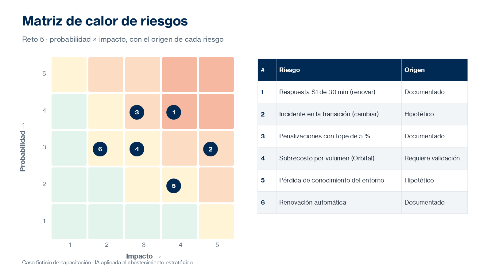

# Práctica 5. Riesgos y contratos

## Metadatos

| Elemento | Valor |
|---|---|
| Duración | 100 minutos (Actividad 1: 30 min · Actividad 2: 35 min · Actividad 3: 35 min) + 10 minutos de discusión grupal |
| Complejidad | Alta |
| Nivel de Bloom | Analizar |

## Descripción General

> Caso transversal ficticio: antes de renegociar, el equipo necesita identificar los riesgos de continuar con el proveedor actual y compararlos con los de contratar uno nuevo. También debe revisar las modificaciones contractuales propuestas en la renovación.

En este reto usas Claude, Copilot Chat o los agentes disponibles para comparar los riesgos operativos, financieros, tecnológicos, de ciberseguridad y de continuidad de renovar o cambiar de proveedor. Construyes una matriz de riesgos y distingues los riesgos documentados, los hipotéticos y los que requieren validación de las áreas técnicas, jurídicas o de seguridad. Después analizas extractos ficticios del contrato para identificar diferencias y ambigüedades, y preparas contrapropuestas. La IA apoya el análisis; las decisiones comerciales y jurídicas corresponden a las personas responsables.



### Actividades del reto (100 minutos)

| Actividad | Duración | Producto |
|---|---|---|
| 1. Identificación de riesgos | 30 min | Matriz de riesgos en Excel |
| 2. Revisión de condiciones contractuales | 35 min | Tabla de observaciones contractuales |
| 3. Preparación de contrapropuestas | 35 min | Documento de observaciones, preguntas y contrapropuestas |

**Entregable del reto:** matriz de riesgos en Excel y documento Word con observaciones contractuales, preguntas y contrapropuestas.

## Objetivos de Aprendizaje

- [ ] Identificar y comparar los riesgos de renovar el contrato frente a cambiar de proveedor.
- [ ] Clasificar riesgos por probabilidad e impacto con criterios explícitos.
- [ ] Distinguir riesgos documentados, hipotéticos y que requieren validación especializada.
- [ ] Revisar condiciones contractuales con IA para detectar cambios, ambigüedades y condiciones que requieren revisión.
- [ ] Elaborar contrapropuestas, preguntas y argumentos sobre SLA, penalizaciones, incrementos y continuidad.

## Prerrequisitos

**Conocimientos**

- Prácticas 1 a 4 completadas.
- Haber participado en la introducción del módulo 5: riesgo de terceros, revisión contractual y supervisión humana.
- Conocimiento general de acuerdos de nivel de servicio (SLA) y cláusulas contractuales.

**Acceso**

- Microsoft 365 Copilot Chat (licencia básica) o Claude (plan gratuito) con carga de archivos.
- Opcional: agentes Researcher y Analyst de Microsoft 365 Copilot.
- Microsoft Excel y Microsoft Word.
- Caso transversal: [assets/caso-transversal-nequi.docx](../assets/caso-transversal-nequi.docx).
- Archivo: [assets/reto05-extractos-contrato.docx](../assets/reto05-extractos-contrato.docx).
- Propuestas para contrastar riesgos y condiciones: [assets/reto03-propuesta-renovacion-tecnosoporte.docx](../assets/reto03-propuesta-renovacion-tecnosoporte.docx), [assets/reto03-oferta-nubia.docx](../assets/reto03-oferta-nubia.docx) y [assets/reto03-oferta-orbital.docx](../assets/reto03-oferta-orbital.docx).
- Entregables de los retos 2 a 4: benchmark, matriz de evaluación y modelo de TCO.

## Entorno de Laboratorio

| Recurso | Versión, edición y arquitectura | Uso |
|---|---|---|
| Microsoft 365 Copilot Chat | Servicio SaaS vigente, licencia básica; arquitectura no aplicable. Fuente oficial: https://learn.microsoft.com/es-es/copilot/privacy-and-protections | Identificación de riesgos y revisión de cláusulas. |
| Claude | Plan gratuito vigente; arquitectura no aplicable. Fuente oficial: https://claude.com/pricing | Alternativa para el análisis de riesgos y cláusulas. |
| Microsoft Excel y Word | Microsoft 365, versión web o de escritorio vigente. Fuente oficial: https://support.microsoft.com/es-es/word | Matriz de riesgos y documento de observaciones. |

### Consideraciones de licencia y configuración

- El análisis de la IA no constituye concepto jurídico. Toda modificación contractual requiere validación del área jurídica.
- Los extractos del contrato son ficticios; no cargues contratos reales en herramientas no autorizadas por la organización.
- En el sector financiero, los riesgos de terceros requieren además la revisión de Riesgos, Cumplimiento y Seguridad de la Información.

### Preparación del espacio de trabajo

Crea la subcarpeta:

`/Curso-IA-Abastecimiento/Reto05`

Crea los archivos:

- `R5_Matriz_Riesgos.xlsx` (a partir de la hoja `R5_Riesgos` de [assets/plantillas-retos.xlsx](../assets/plantillas-retos.xlsx))
- `R5_Observaciones_Contractuales.docx`

## Instrucciones Paso a Paso

### Actividad 1. Identificación de riesgos — 30 min

#### Paso 1: Identificar riesgos de renovar y de cambiar

**Objetivo:** Obtener una lista comparativa de riesgos por categoría.

**Instrucciones:**

1. Adjunta o consulta el caso, las tres propuestas, los extractos contractuales y tus entregables de los retos 2 a 4 (benchmark, matriz de evaluación y resumen/modelo económico). Envía el prompt:

```text
Actúa como analista de riesgo de terceros. Compara los riesgos de renovar el
contrato con el proveedor actual frente a cambiar a Nubia u Orbital (caso ficticio).
Considera factores operativos, financieros, tecnológicos, de ciberseguridad y de
continuidad del servicio.

Para cada riesgo indica: alternativa, categoría, descripción, archivo y sección de
evidencia (o «sin evidencia») y área que debería validarlo.
Formato: tabla. No presentes como hechos riesgos que no estén en la documentación.
```

2. Elimina riesgos genéricos que no apliquen al caso.

**Resultado esperado:** Lista de al menos seis riesgos con evidencia o sin ella.

**Verificación:** Hay riesgos tanto de renovar como de cambiar.

#### Paso 2: Construir la matriz de riesgos

**Objetivo:** Clasificar los riesgos con criterios explícitos.

**Instrucciones:**

1. Registra los riesgos en `R5_Matriz_Riesgos.xlsx`.
2. Asigna probabilidad e impacto de 1 a 5 y calcula `Nivel = Probabilidad × Impacto`.
3. Clasifica el origen de cada riesgo:
   - `Documentado`: se desprende de las propuestas o del contrato.
   - `Hipotético`: posible, sin evidencia en la documentación.
   - `Requiere validación`: debe confirmarlo el área técnica, jurídica o de seguridad.
4. Documenta en una nota los criterios usados para asignar probabilidad e impacto.
5. Aplica formato condicional por nivel para obtener una matriz de calor.

**Resultado esperado:** Matriz de riesgos clasificada y justificada.

**Verificación:** El riesgo «respuesta S1 de 30 minutos» aparece como `Documentado` y el de «incidente durante la transición» como `Hipotético`.

### Actividad 2. Revisión de condiciones contractuales — 35 min

#### Paso 3: Revisar las condiciones contractuales

**Objetivo:** Detectar cambios, impactos y ambigüedades entre el contrato vigente y la propuesta.

**Instrucciones:**

1. Carga [assets/reto05-extractos-contrato.docx](../assets/reto05-extractos-contrato.docx).
2. Envía el prompt:

```text
Actúa como analista de abastecimiento que apoya la revisión contractual (no como
abogado). Compara las cláusulas del contrato vigente con la propuesta de renovación.

Para cada cláusula indica: cambio detectado, impacto para Nequi (favorable, neutral,
desfavorable), ambigüedades y preguntas.
Formato: tabla Cláusula | Vigente | Propuesta | Impacto | Ambigüedad | Requiere revisión de.

Cita literalmente el texto relevante. No emitas conclusiones jurídicas.
```

3. Verifica cada cambio contra el documento.

**Resultado esperado:** Tabla de observaciones de las siete cláusulas.

**Verificación:** La tabla detecta, entre otros, el cambio de respuesta S1 de 15 a 30 minutos, el tope de penalizaciones de 15 % a 5 % y la renovación automática.

#### Paso 4: Identificar ambigüedades y validaciones especializadas

**Objetivo:** Señalar la redacción que admite varias interpretaciones y quién debe revisarla.

**Instrucciones:**

1. Revisa expresiones como «tiempo razonable», «procurará», «oportunamente» y «periodo posterior razonable».
2. Pide a la IA que proponga preguntas de aclaración para cada ambigüedad.
3. Asigna el área responsable de validar cada observación: Jurídico, Tecnología, Seguridad de la Información o Riesgos.

**Resultado esperado:** Lista de ambigüedades con pregunta y responsable.

**Verificación:** Ninguna observación se presenta como conclusión jurídica definitiva.

### Actividad 3. Preparación de contrapropuestas — 35 min

#### Paso 5: Preparar contrapropuestas

**Objetivo:** Proponer modificaciones fundamentadas a las condiciones de renovación.

**Instrucciones:**

1. En `R5_Observaciones_Contractuales.docx`, crea una tabla: `Tema | Condición propuesta | Contrapropuesta de Nequi | Argumento`.
2. Incluye al menos estos temas: respuesta S1, penalizaciones, renovación, terminación anticipada, ajuste de precio y notificación de incidentes.
3. Sustenta cada argumento con un dato de los retos anteriores (benchmark, evaluación, TCO o riesgos).
4. Pide a la IA que redacte preguntas para el proveedor actual y revísalas.

**Resultado esperado:** Contrapropuestas con argumentos basados en evidencia.

**Verificación:** Cada contrapropuesta cita el dato que la respalda.

#### Paso 6: Consolidar el documento de observaciones

**Objetivo:** Entregar un documento listo para validación especializada.

**Instrucciones:**

1. Organiza el documento: resumen de riesgos, observaciones por cláusula, preguntas al proveedor, contrapropuestas y validaciones pendientes.
2. Agrega la nota: «Documento de apoyo elaborado con IA; requiere validación de Jurídico, Riesgos y Seguridad de la Información».

**Resultado esperado:** Documento de observaciones completo.

**Verificación:** La sección de validaciones pendientes asigna un área a cada tema.

### Discusión grupal — 10 min

#### Paso 7: Participar en la discusión grupal

**Objetivo:** Contrastar riesgos y condiciones contractuales.

**Instrucciones:**

1. Compara tu clasificación de riesgos con la de otro participante.
2. Comparte una afirmación de la IA que requirió validación jurídica.
3. Registra la contrapropuesta que el grupo consideró más sólida.

**Resultado esperado:** Observaciones del grupo incorporadas.

**Verificación:** El documento incluye al menos un ajuste derivado de la discusión.

## Validación y Pruebas

La práctica se considera lograda cuando se cumplen todos los criterios medibles siguientes:

| Criterio | Evidencia mínima | Resultado requerido |
|---|---|---|
| Matriz de riesgos | `R5_Matriz_Riesgos.xlsx` | Seis o más riesgos de ambas alternativas con probabilidad, impacto y nivel. |
| Origen del riesgo | Columna de origen | Todos los riesgos clasificados como documentado, hipotético o requiere validación. |
| Revisión contractual | Tabla de observaciones | Siete cláusulas revisadas con impacto y ambigüedades. |
| Contrapropuestas | `R5_Observaciones_Contractuales.docx` | Seis temas con contrapropuesta y argumento sustentado. |
| Supervisión | Validaciones pendientes | Área responsable asignada a cada observación. |

### Caso adversarial: conclusión jurídica categórica

Analiza esta situación: la IA responde «la cláusula de terminación anticipada es nula y Nequi puede ignorarla».

**Resultado esperado de la evaluación humana:**

- Clasificación: afirmación jurídica no sustentada, fuera del alcance de la IA.
- Acción: no incluirla en el documento; registrar la cláusula como observación para revisión del área jurídica.
- Aprendizaje: la IA identifica diferencias y ambigüedades; la validez jurídica la determina el área jurídica.

## Solución de Problemas

### Problema 1: La IA presenta riesgos hipotéticos como hechos

**Síntoma:** La matriz incluye afirmaciones sobre los proveedores que no aparecen en los documentos.

**Causa probable:** El prompt no exige evidencia documental.

**Solución:** Agrega al prompt: «Para cada riesgo, cita el documento y la sección o escribe "sin evidencia"». Reclasifica esos riesgos como `Hipotético`.

### Problema 2: La IA omite cláusulas

**Síntoma:** La tabla de observaciones tiene menos cláusulas que el documento.

**Causa probable:** Respuesta resumida o documento largo.

**Solución:** Pide la revisión cláusula por cláusula, indicando los números: 5, 8, 11, 12, 14, 16 y 18.

## Limpieza

1. Guarda la matriz y el documento en `/Curso-IA-Abastecimiento/Reto05`.
2. Conserva el prompt de revisión contractual para la biblioteca del reto 7.
3. No compartas el documento de observaciones fuera del curso: contiene contrapropuestas del caso.

## Resumen (+ optional resources)

En este reto se identificaron y clasificaron los riesgos de renovar y de cambiar de proveedor, se revisaron las cláusulas contractuales con apoyo de IA y se prepararon contrapropuestas sustentadas. La IA permitió detectar cambios y ambigüedades, mientras que la validación jurídica, de riesgos y de seguridad se mantiene en las áreas responsables.

Las contrapropuestas son insumo de la estrategia de negociación del reto 6.

**Recursos opcionales:**

- Microsoft Learn: [Privacidad y protecciones de Copilot Chat](https://learn.microsoft.com/es-es/copilot/privacy-and-protections)
- Anthropic: [Be clear, direct, and detailed](https://platform.claude.com/docs/en/build-with-claude/prompt-engineering/be-clear-and-direct)
- Anthropic: [Reduce hallucinations](https://platform.claude.com/docs/en/test-and-evaluate/strengthen-guardrails/reduce-hallucinations)

---

[Volver al inicio](../README.md)
