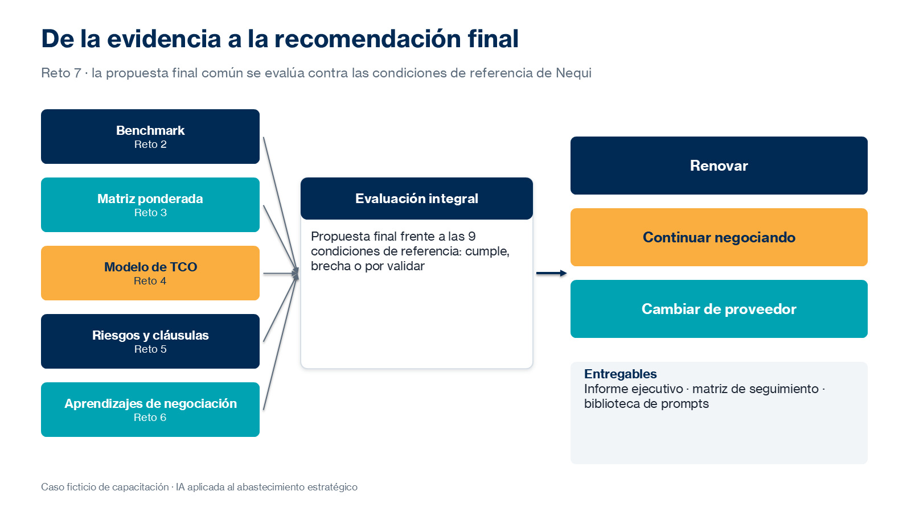

# Práctica 7. Asistentes especializados

## Metadatos

| Elemento | Valor |
|---|---|
| Duración | 100 minutos (Actividad 1: 20 min · Actividad 2: 45 min · Actividad 3: 35 min) + 10 minutos de discusión grupal |
| Complejidad | Alta |
| Nivel de Bloom | Crear |

## Descripción General

> Caso transversal ficticio: después de la simulación de negociación, el instructor entrega una propuesta final ficticia del proveedor actual, junto con las condiciones de referencia establecidas por Nequi. Todos los participantes trabajan con esta misma información.

En este reto recuperas y adaptas las instrucciones y prompts especializados desarrollados durante el curso para evaluar la propuesta final. Usas instrucciones especializadas, Claude Projects (según disponibilidad), prompts reutilizables de Copilot Chat o los agentes Researcher y Analyst si los tienes. Integras los resultados de la investigación de mercado, la evaluación de ofertas, el análisis económico y la revisión de riesgos, verificas los resultados contra los documentos originales y elaboras una recomendación ejecutiva para la Dirección de Abastecimiento: renovar, continuar la negociación o cambiar de proveedor. Cierras con una matriz de seguimiento y una biblioteca reutilizable de instrucciones y prompts.



### Actividades del reto (100 minutos)

| Actividad | Duración | Producto |
|---|---|---|
| 1. Especialización de asistentes | 20 min | Instrucción especializada probada |
| 2. Aplicación al caso transversal | 45 min | Evaluación integral verificada |
| 3. Recomendación ejecutiva y seguimiento | 35 min | Informe ejecutivo, matriz de seguimiento y biblioteca de prompts |

**Entregable del reto:** informe ejecutivo de recomendación final de contratación en Word, matriz de seguimiento en Excel y biblioteca consolidada de instrucciones y prompts reutilizables.

## Objetivos de Aprendizaje

- [ ] Especializar instrucciones con objetivos, fuentes, restricciones y formato de salida.
- [ ] Evaluar la propuesta final frente a las condiciones de referencia de Nequi.
- [ ] Integrar los resultados de los retos anteriores y verificarlos contra los documentos originales.
- [ ] Elaborar una recomendación ejecutiva justificada con criterios económicos, operativos, contractuales y de riesgo.
- [ ] Preparar una matriz de seguimiento y una biblioteca reutilizable de instrucciones y prompts.

## Prerrequisitos

**Conocimientos**

- Prácticas 1 a 6 completadas.
- Haber participado en la introducción del módulo 7: consolidación de resultados, instrucciones especializadas y elaboración de informes ejecutivos.

**Acceso**

- Microsoft 365 Copilot Chat (licencia básica) o Claude (plan gratuito).
- Opcional: Claude Projects, según disponibilidad del plan; agentes Researcher y Analyst de Microsoft 365 Copilot.
- Microsoft Excel y Microsoft Word.
- Archivos del reto:
  - [assets/reto07-propuesta-final.docx](../assets/reto07-propuesta-final.docx)
  - [assets/reto07-condiciones-referencia-nequi.docx](../assets/reto07-condiciones-referencia-nequi.docx)
- Entregables y prompts de los retos 1 a 6.

## Entorno de Laboratorio

| Recurso | Versión, edición y arquitectura | Uso |
|---|---|---|
| Claude y Claude Projects | Plan gratuito vigente; Projects según disponibilidad del plan. Fuente oficial: https://support.claude.com/en/articles/9517075-what-are-projects | Asistente especializado con instrucciones y documentos del caso. |
| Microsoft 365 Copilot Chat | Servicio SaaS vigente, licencia básica; arquitectura no aplicable. Fuente oficial: https://learn.microsoft.com/es-es/copilot/overview | Evaluación con prompts reutilizables. |
| Researcher y Analyst (opcional) | Agentes de Microsoft 365 Copilot; requieren licencia Microsoft 365 Copilot. Fuente oficial: https://support.microsoft.com/es-es/topic/e63ab760-f3de-4c47-ae87-dad601b0e9c4 | Evaluación integral y análisis de datos. |
| Microsoft Excel y Word | Microsoft 365, versión web o de escritorio vigente. Fuente oficial: https://support.microsoft.com/es-es/word | Informe, matriz de seguimiento y biblioteca de prompts. |

### Consideraciones de licencia y configuración

- Si Projects no está disponible, pega la instrucción especializada al inicio de una conversación nueva y carga los documentos en esa misma conversación.
- La recomendación final se elabora con la propuesta común del instructor, no con el resultado individual de la simulación del reto 6.
- Toda recomendación es un insumo para la decisión de la Dirección; no sustituye las aprobaciones formales.

### Preparación del espacio de trabajo

Crea la subcarpeta:

`/Curso-IA-Abastecimiento/Reto07`

Crea los archivos:

- `R7_Instruccion_Evaluacion_Final.txt`
- `R7_Informe_Recomendacion_Final.docx`
- `R7_Seguimiento_y_Biblioteca.xlsx` (con las hojas `R7_Seguimiento` y `R7_Biblioteca_prompts` de [assets/plantillas-retos.xlsx](../assets/plantillas-retos.xlsx))

## Instrucciones Paso a Paso

### Actividad 1. Especialización de asistentes — 20 min

#### Paso 1: Recuperar y seleccionar instrucciones

**Objetivo:** Identificar los prompts de los retos anteriores útiles para la evaluación final.

**Instrucciones:**

1. Reúne los prompts de los retos 1 a 6: diagnóstico, investigador, extracción, estructura de TCO, revisión contractual y análisis de contrapropuestas.
2. Selecciona los que servirán para evaluar la propuesta final y anota por qué.

**Resultado esperado:** Lista de prompts seleccionados con su propósito.

**Verificación:** La lista incluye al menos un prompt de extracción, uno económico y uno de riesgos o contratos.

#### Paso 2: Especializar la instrucción de evaluación

**Objetivo:** Definir objetivos, fuentes, restricciones y formato del asistente.

**Instrucciones:**

1. Adapta esta instrucción base y guárdala en `R7_Instruccion_Evaluacion_Final.txt`:

```text
Eres analista senior de abastecimiento de Nequi (caso ficticio de capacitación).

Fuentes, en orden de prioridad:
1. Condiciones de referencia de Nequi.
2. Propuesta final del proveedor.
3. Entregables de los retos 2 a 6.

Tarea: evalúa la propuesta final condición por condición: cumple / no cumple / brecha,
con la sección de origen.

Restricciones: no inventes datos; si falta información escribe «No especificado»;
separa hechos, cálculos y supuestos.

Formato: tabla de cumplimiento, resumen de brechas y tres alternativas
(renovar, continuar negociando, cambiar de proveedor) con pros y contras.
```

2. Configura la herramienta:
   - **Claude con Projects:** crea un proyecto, pega la instrucción en las instrucciones del proyecto y carga los documentos del caso como conocimiento.
   - **Claude sin Projects o Copilot Chat:** pega la instrucción al inicio de una conversación nueva y carga los documentos.
   - **Researcher o Analyst:** usa la instrucción como solicitud al agente.

**Resultado esperado:** Asistente especializado configurado.

**Verificación:** La instrucción define fuentes con prioridad, restricciones y formato de salida.

#### Paso 3: Probar y ajustar la instrucción

**Objetivo:** Confirmar que el asistente responde según lo esperado.

**Instrucciones:**

1. Pide una evaluación de prueba de dos condiciones: incremento máximo y respuesta S1.
2. Verifica que cite la sección de origen y que no invente información.
3. Ajusta la instrucción si es necesario y registra el cambio.

**Resultado esperado:** Instrucción probada y ajustada.

**Verificación:** El asistente identifica que el incremento propuesto (9 %) supera el máximo de referencia (8 %).

### Actividad 2. Aplicación al caso transversal — 45 min

#### Paso 4: Evaluar la propuesta final

**Objetivo:** Comparar la propuesta final con las condiciones de referencia de Nequi.

**Instrucciones:**

1. Solicita la evaluación completa de las nueve condiciones de referencia.
2. Revisa la tabla resultante. El resultado esperado es:
   - Incremento: no cumple (9 % frente a un máximo de 8 %).
   - Disponibilidad, respuesta S1, penalizaciones, renovación, terminación, plan de continuidad y ajuste posterior por IPC: cumplen.
   - Notificación de incidentes: no especificada, requiere validación.
3. Calcula en Excel el TCO de la propuesta final: 180 × 1,09 × 36 = COP 7.063,2 M (sin indexación).

**Resultado esperado:** Tabla de cumplimiento verificada.

**Verificación:** Cada resultado coincide con el texto de la propuesta final y de las condiciones de referencia.

#### Paso 5: Integrar los resultados de los retos anteriores

**Objetivo:** Fundamentar la evaluación con todo el caso.

**Instrucciones:**

1. Integra en una tabla:
   - Mercado (reto 2): competitividad frente a alternativas.
   - Evaluación (reto 3): puntajes de las ofertas.
   - Economía (reto 4): TCO de la propuesta final frente a +8 %, Nubia y Orbital.
   - Riesgos (reto 5): riesgos que persisten o se mitigan.
   - Negociación (reto 6): aprendizajes sobre la flexibilidad del proveedor.
2. Verifica las cifras contra los documentos y modelos originales.

**Resultado esperado:** Evaluación integral sustentada.

**Verificación:** El TCO de la propuesta final (7.063,2 M) se compara con el punto de reserva (6.998,4 M) y con Nubia (7.206,0 M).

### Actividad 3. Recomendación ejecutiva y seguimiento — 35 min

#### Paso 6: Elaborar la recomendación ejecutiva

**Objetivo:** Recomendar una alternativa a la Dirección de Abastecimiento.

**Instrucciones:**

1. Elige una alternativa: renovar con las condiciones propuestas, continuar la negociación o cambiar a un proveedor alternativo.
2. Pide a tu asistente un borrador con esta estructura y revísalo cifra por cifra:
   1. Recomendación en una frase.
   2. Justificación económica, operativa, contractual y de riesgo.
   3. Beneficios esperados.
   4. Riesgos que requieren mitigación.
   5. Aspectos pendientes de validación o aprobación.
3. Guarda el informe en `R7_Informe_Recomendacion_Final.docx`.

**Resultado esperado:** Informe ejecutivo con una recomendación justificada.

**Verificación:** El informe identifica la brecha de 1 punto en el incremento y la falta de compromiso de notificación de incidentes en 24 horas.

#### Paso 7: Preparar el seguimiento y la biblioteca de prompts

**Objetivo:** Dejar acciones asignadas e instrucciones reutilizables.

**Instrucciones:**

1. En la hoja `R7_Seguimiento`, registra las acciones con responsable propuesto, fecha ficticia y estado. Ejemplos:
   - Negociar la brecha de 1 punto en el incremento · Líder de negociación.
   - Confirmar la notificación de incidentes en 24 horas · Seguridad de la Información.
   - Validar la redacción de las cláusulas · Jurídico.
   - Aprobar la recomendación · Dirección de Abastecimiento.
2. En la hoja `R7_Biblioteca_prompts`, registra cada prompt e instrucción del curso con: nombre, etapa, herramienta, propósito, texto, versión, resultado probado y observaciones.

**Resultado esperado:** Matriz de seguimiento y biblioteca consolidada.

**Verificación:** La biblioteca contiene al menos seis prompts, uno por cada reto del 1 al 6, más la instrucción de evaluación final.

### Discusión grupal — 10 min

#### Paso 8: Participar en la discusión grupal

**Objetivo:** Contrastar recomendaciones y criterios.

**Instrucciones:**

1. Presenta tu recomendación si el instructor te selecciona.
2. Compara tus argumentos económicos, operativos, contractuales y de riesgo con los de otros participantes.
3. Comparte una oportunidad para reutilizar la biblioteca en tu trabajo.

**Resultado esperado:** Oportunidades de reutilización identificadas.

**Verificación:** La biblioteca incluye observaciones de uso surgidas de la discusión.

## Validación y Pruebas

La práctica se considera lograda cuando se cumplen todos los criterios medibles siguientes:

| Criterio | Evidencia mínima | Resultado requerido |
|---|---|---|
| Instrucción especializada | `R7_Instruccion_Evaluacion_Final.txt` | Rol, fuentes con prioridad, criterios, restricciones y formato; probada y ajustada. |
| Evaluación | Tabla de cumplimiento | Nueve condiciones evaluadas y verificadas contra los documentos. |
| Integración | Tabla de evaluación integral | Resultados de los retos 2 a 6 incorporados con cifras verificadas. |
| Recomendación | `R7_Informe_Recomendacion_Final.docx` | Una alternativa recomendada, justificada, con beneficios, riesgos y pendientes. |
| Seguimiento y biblioteca | `R7_Seguimiento_y_Biblioteca.xlsx` | Acciones con responsable y fecha; biblioteca con siete o más entradas. |

### Caso adversarial: recomendación que contradice las condiciones de referencia

Analiza esta situación: el asistente concluye «La propuesta final cumple todas las condiciones de referencia; se recomienda renovar».

**Resultado esperado de la evaluación humana:**

- Clasificación: conclusión incorrecta; el incremento del 9 % supera el máximo de 8 % y la notificación de incidentes no está especificada.
- Acción: corregir la tabla de cumplimiento y revisar si la instrucción especializada exige evaluar condición por condición.
- Aprendizaje: una recomendación solo es válida si cada conclusión se verifica contra los documentos originales.

## Solución de Problemas

### Problema 1: Claude Projects no está disponible

**Síntoma:** No aparece la opción para crear proyectos.

**Causa probable:** La función no está disponible en el plan o la configuración de la cuenta.

**Solución:** Pega la instrucción especializada al inicio de una conversación nueva y carga allí los documentos del caso. El resultado del reto es equivalente.

### Problema 2: El asistente mezcla la simulación individual con la propuesta común

**Síntoma:** La evaluación usa condiciones negociadas en el reto 6 en lugar de la propuesta final del instructor.

**Causa probable:** La instrucción no define la prioridad de las fuentes.

**Solución:** Indica en la instrucción que la propuesta final del instructor es la única fuente de condiciones del proveedor y que el reto 6 solo aporta aprendizajes.

## Limpieza

1. Guarda los tres archivos en `/Curso-IA-Abastecimiento/Reto07`.
2. Conserva la biblioteca de prompts para reutilizarla en tu trabajo, sustituyendo la información ficticia por información autorizada en herramientas aprobadas por la organización.
3. Si creaste un proyecto en Claude con los documentos del caso, elimínalo o archívalo si ya no lo necesitas.

## Resumen (+ optional resources)

En este reto se especializaron instrucciones para evaluar la propuesta final, se integraron los resultados de todo el caso y se elaboró una recomendación ejecutiva justificada, acompañada de una matriz de seguimiento y una biblioteca reutilizable de instrucciones y prompts.

El curso cierra con un flujo completo de abastecimiento asistido por IA: investigación, evaluación, análisis económico, riesgos, negociación y recomendación, siempre con verificación y supervisión humana.

**Recursos opcionales:**

- Claude Help Center: [What are projects?](https://support.claude.com/en/articles/9517075-what-are-projects)
- Microsoft Support: [Introducción a Analyst en Microsoft 365 Copilot](https://support.microsoft.com/es-es/microsoft-365-copilot/get-started-with-analyst-in-microsoft-365-copilot)
- Microsoft Learn: [Información general de Microsoft 365 Copilot](https://learn.microsoft.com/es-es/copilot/microsoft-365/microsoft-365-copilot-overview)
- Microsoft Learn: [Crear prompts eficaces para Microsoft 365 Copilot](https://learn.microsoft.com/es-es/training/paths/craft-effective-prompts-copilot-microsoft-365/)

---

[Volver al inicio](../README.md)
